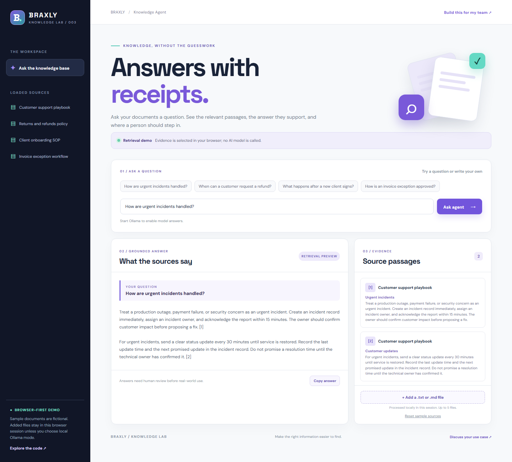

# Knowledge Agent

A source-grounded knowledge assistant from [Braxly](https://github.com/braxlyco). Ask a question, inspect the retrieved passages, and see exactly what supports the answer.

**[Try the browser demo](https://braxlyco.github.io/knowledge-agent/)**



## What it does

- Searches four fictional business documents covering support incidents, refunds, onboarding, and invoice approvals.
- Shows source passages and numbered citations with every supported answer.
- Refuses to guess when the loaded sources do not support a question.
- Accepts up to five `.txt` or `.md` files in the browser session. In the public demo, files are processed locally and are not uploaded.
- Can use a **real local Ollama model** when run through the included Node server. Relevant excerpts go to Ollama on your computer; the answer remains linked to its sources.

## Demo and local AI modes

The GitHub Pages version is a **retrieval preview**. It selects and displays relevant source text without calling a language model. The example documents are fictional.

For local AI answers, install [Ollama](https://ollama.com/), start its service, and pull a model:

```bash
ollama pull llama3.2:3b
npm start
```

Open <http://127.0.0.1:5175>. If the model is available, the interface offers a **Use local AI** button. Set `OLLAMA_MODEL` to another installed model name if preferred; `OLLAMA_URL` can point to another compatible Ollama endpoint. The server binds to `127.0.0.1` by default.

Model answers can still be wrong. Review the cited passages before using them. The local server has no user accounts or production access controls; it is a development demo.

## Run checks

Requires Node.js 24. No npm dependencies or API key are needed.

```bash
npm test
```

The tests cover retrieval, unsupported questions, input limits, prompt construction, and the Ollama chat adapter with a mock response.

## Project map

```text
index.html, styles.css       Responsive browser interface
src/sample-docs.js           Fictional sample knowledge base
src/knowledge.js             Search, citations, and browser preview
src/app.js                   UI, local file import, and mode switching
server/agent.js              Ollama request validation and grounded prompt
server/server.js             Local-only static and API server
tests/                       Retrieval and adapter tests
```

For a real company knowledge agent with permissions, document sync, and deployment, contact [contactbraxly@gmail.com](mailto:contactbraxly@gmail.com).

MIT licensed. See [LICENSE](LICENSE).
